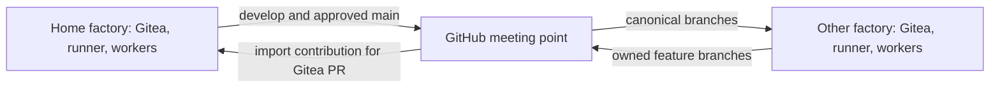

# Multiple factories synchronizing through GitHub

**Design proposal — status: draft.** This document proposes a topology and
operating contract; it does not describe a shipped synchronization service.
The registry, timer and cross-factory handoff below are not implemented or
validated. Adopting them requires a separate implementation and isolated pilot.
See the [glossary](glossary.md) for factory, runner, worker, coordinator, PR,
merge gate and receipt; the existing [lifecycle](lifecycle.md) remains the
baseline for review, evidence and separation of responsibilities.

## Topology and authority

Each factory is independent: its own Gitea server, Actions runner, workers,
credentials and storage, plus its own Moonlighter coordinator when needed.
Factories do not share databases, queues or worker claims. GitHub is the meeting
point for Git history, so factories need not reach one another directly.

Every repository has **exactly one home factory**. Its Gitea holds the canonical
issues and development PRs. Only its merge gate merges PRs into `develop`, and
only its authorized distribution process pushes `develop` and `main` to GitHub.
Other factories keep copies from GitHub and contribute feature branches or PRs.
A factory can host one repository while mirroring another.



Here, **hosted** means this factory is the repository's home; **mirrored** means
it follows another home. A mirrored repository in this proposal is an ordinary
writable Gitea repository with protected canonical branches, not necessarily a
Gitea built-in pull mirror. Only the sync identity may advance those branches
from GitHub; local workers write feature branches.

Use globally distinct branch names, such as
`factory/factory-b/feature/issue-42`, with one factory owning each namespace and
one worker writing each branch. Issue numbers must include their Gitea instance
and repository when used outside that instance. Moonlighter claims only prevent
collisions within one coordinator; they are not a distributed locking service.
Before going offline, allocate separate work to each factory. Unplanned offline
work is a proposal until the home accepts it, not a second authoritative job.

Git sync transfers commits and selected refs, not Gitea issues, PR comments,
review status, CI results, coordinator claims or private receipts. A contribution
handoff must identify the canonical issue URL, source factory, branch, base/head
SHAs and validation results. Store private evidence separately. The home imports
the branch, creates a Gitea PR targeting `develop`, and runs its own current-head
review and checks. Local review elsewhere is useful evidence but cannot grant
home merge clearance. Mirrored factories must not report an issue complete until
the home merge and acceptance evidence are verified; see
[Moonlighter's completion and recovery gaps](moonlighter.md#known-gaps-before-a-multi-computer-rollout).

## Proposed per-factory registry

Keep a factory-owned configuration file outside project checkouts, for example
`~/.config/gitea-code-factory/sync.json`. This path, all names and all URLs below
are examples, not prerequisites. This is an illustrative schema, not a file
accepted by an existing helper:

```json
{
  "schema_version": 1,
  "factory_id": "factory-b",
  "sync_interval_seconds": 300,
  "repositories": [
    {
      "id": "example-owner/tool",
      "role": "hosted",
      "home_factory": "factory-b",
      "ownership_generation": 1,
      "github_url": "https://github.com/example-owner/tool",
      "remotes": {
        "local_gitea": "http://localhost:3300/example-owner/tool.git",
        "github": "https://github.com/example-owner/tool.git"
      },
      "canonical_branches": ["develop", "main"],
      "feature_prefix": "factory/factory-b/",
      "main_policy": "approved-release-only"
    },
    {
      "id": "example-owner/app",
      "role": "mirrored",
      "home_factory": "factory-a",
      "ownership_generation": 3,
      "github_url": "https://github.com/example-owner/app",
      "remotes": {
        "local_gitea": "http://localhost:3300/example-owner/app.git",
        "github": "https://github.com/example-owner/app.git"
      },
      "canonical_branches": ["develop", "main"],
      "feature_prefix": "factory/factory-b/",
      "main_policy": "follow-home"
    }
  ]
}
```

The future validator should reject duplicate repository IDs, inconsistent
hosted/home combinations, unknown fields or versions, credentials embedded in
URLs, ambiguous remotes and overlapping feature namespaces. A hosted entry must
name the local factory as home; a mirrored entry must name another factory.
Repository identity and GitHub visibility must be verified before export.
Enrollment in Moonlighter is a separate explicit action, not a side effect of
adding a registry entry.

Never put secrets in this file: no tokens, passwords, private keys or signed
URLs. Resolve authentication through private credential storage under a separate
identity for sync. Logs and runtime state also belong outside Git. A sanitized
registry may be reviewed in an operations repository; host-specific copies stay
local. Registry agreement alone cannot enforce single ownership: protect
`develop` and `main` on GitHub so only the current home's distribution identity
can update them, and deny force pushes and deletions. Contributor identities
must have no canonical-branch bypass. Protection capabilities and permissions
must be proven in the pilot before enabling writes.

## Sync mechanics and alternatives

| Approach | Advantages | Limits for this proposal |
|---|---|---|
| Timer-driven script | Explicit directions and refs, ancestry checks, release gate, per-repo reporting; works with ordinary writable Gitea repositories | New code to build, test and operate; needs locks, retry state and private credentials |
| Gitea built-in push mirror | Server-managed scheduling and error display | Documented force-push behavior conflicts with the no-force rule; Moonlighter currently holds PRs when outbound mirrors exist |
| Gitea built-in pull mirror | Server-managed periodic import, useful for a separate browsing copy | Does not provide the contribution/evidence handoff or the proposed guarded writable-repo workflow; version-specific ref behavior needs verification |

The [Gitea 1.26 mirror documentation](https://docs.gitea.com/1.26/usage/repository/repo-mirror/)
describes periodic pull and push mirrors, warns that push mirroring overwrites
remote changes with force pushes, and requires creating a new repository for a
pull mirror. Those documented behaviors are not validation of the kit's pinned
version. Built-in push mirrors are therefore excluded from this design. A pull
mirror is only a possible separate read-only cache after testing; it must not
be a second sync writer. The [existing mirror notes](gitea-prerequisites.md#7-mirroring-to-github-ssh-is-not-available)
record version-specific observations, not permission to enable this topology.

Propose a timer-driven script, initially every five minutes with jitter and
bounded retries. Run it on the factory host, independently of worker checkouts,
with a private bare cache and a per-repository lock. A systemd timer in Linux/WSL
is one deployment option; Windows scheduling and WSL startup need pilot testing.
No existing script is being installed by this proposal.

Each cycle would:

1. Validate the registry and current ownership generation. Refuse writes if
   ownership cannot be confirmed online; offline local work can continue.
2. Fetch the allowed source and destination refs into separate observation
   namespaces. Record both SHAs before deciding anything. Never reset a worker
   checkout or use a destructive mirror clone as the destination repository.
3. For hosted repos, export home `develop`; export `main` only when an explicit
   release approval names the exact SHA. For mirrored repos, import GitHub
   `develop` and `main` into local Gitea. Export only locally owned, explicitly
   approved feature branches, and import selected contributions at the home.
4. If SHAs match, do nothing. If the destination is an ancestor of the source,
   push the explicit ref normally. Missing branches require an explicit bootstrap
   or contribution authorization. If the destination is ahead of the source,
   or neither is an ancestor, stop that branch and report both SHAs. Do not
   automatically merge divergent history or reverse the configured direction.
5. Re-read the destination after a push and record the observed result. A race
   or rejected push triggers a fresh fetch and comparison, not a stronger push.
   Partial success is recorded per ref; the next cycle safely repeats the check.

**No force pushes ever**, including `--force-with-lease`, `+` push refspecs and
`git push --mirror`. No wildcard pushes, automatic pruning or branch/tag deletion.
Published feature branches advance by new commits; a rewritten contribution uses
a new branch name. An operator resolves divergence through reviewed additive
commits, then explicitly clears the hold. Other independent repositories can
continue syncing while a branch is held.

Persist the last successful sync, source/destination SHAs, direction, ownership
generation, error and retry time. Reports must distinguish offline, unauthorized,
diverged, release-blocked and synchronized states without exposing credentials.
Offline alerts accumulate locally and are delivered when connectivity returns;
the reporting destination remains an implementation choice.

## Branch and release rules

- **Gitea development PRs target `develop`.** Only the home gate merges them;
  PRs on a mirrored factory are preliminary review and remain unmerged there.
- **GitHub PRs target `main` for releases.** Feature contributions travel as
  branches and become development PRs at the home, not GitHub feature merges.
- **Only the home pushes `develop` and `main` to GitHub.** GitHub release PRs
  are review records, not an independent merge authority.

To satisfy all three rules, the proposed release flow opens a GitHub release PR
from the synchronized `develop` to `main`, records approval for exact head/base
SHAs, validates the release at home, and advances home `main` to the approved
commit before pushing that same commit to GitHub. Prefer fast-forward promotion
so `main` remains an ancestor of `develop`. If ancestry differs, stop and reconcile
through the home workflow before promotion. Disable GitHub auto-merge and direct
merge actions for this flow: a GitHub-created merge or squash commit would create
a second writer. Reconcile the release PR after the push with links to the final
SHA, closing it explicitly if necessary. A changed candidate invalidates approval.

This adds continuous `develop` distribution to the existing
[release-only proposal](releases.md); it does not make every sync a release.
Tags and assets remain explicit release operations by the home, with immutable
tags and human authorization for publication. Git LFS objects and submodule
availability need separate verification; equal Git refs alone are insufficient.

## Adding a factory: Windows/WSL pilot

A standalone Windows computer running Windows Subsystem for Linux (WSL) is a
proposed proof of concept, not an already-supported deployment proven by this kit.
Use a fresh factory clone inside WSL's Linux filesystem, with its own persistent
Gitea data, runner registration and worker credentials. Follow [setup](setup.md)
from that clone's root and [onboarding](onboarding.md) with disposable repositories.
No private upstream repository or access to an existing factory is required.

Initially expose Gitea only locally; `http://localhost:3300` is an example browser
address. Verify actual bind addresses, Windows/WSL forwarding and firewall rules.
A container's `localhost` is itself: the supplied runner/jobs use the internal
Gitea address described in setup. Prove browser, worker and runner connectivity
separately. Do not reuse another factory's database, runner registration or queue.

First test a locally hosted disposable project. Then, with explicit permission
for disposable GitHub repositories, test one hosted and one mirrored entry against
a second isolated factory. Confirm smoke CI and home review/merge gates, followed
by ordinary branch sync. Pre-cache required toolchains, packages, container images
and Git objects before disconnecting. Offline Git development and local CI are
possible only with available dependencies; cloud agent providers and remote APIs
may remain unavailable. WSL/Windows sleep can suspend workers and timers.

Before real enrollment, demonstrate loss/recovery of connectivity, duplicate timer
runs, a rejected non-fast-forward push, a conflicting contribution, stale release
approval, restart after partial sync, and a fenced home transfer. Verify unchanged
destination history on every rejected operation. The sync implementation would
need isolated tests with mock APIs and disposable repositories; this draft does
not claim those tests exist.

Later, joining a local area network (LAN) or Tailscale private network changes
reachability, not ownership. Choose a stable reachable URL, update Gitea's external
URL and SSH settings, registry URLs, worker configuration and affected runner
registration deliberately. Configure firewall/TLS and test from each participant.
`https://gitea-b.example.test` is an illustrative hostname, not a real prerequisite.
Back up configuration and data before the move. GitHub remains the meeting point;
a direct inter-factory network connection is optional and grants no merge rights.

## Failures and changing a repository's home

| Failure | Required response |
|---|---|
| GitHub or network offline | Keep local work and pending refs; retry with backoff. Home may merge locally, but distribution and remote handoff wait. Never interpret a stale mirror as current. |
| Authentication or protection failure | Hold writes, report the failed operation and repair credentials/rules deliberately; never bypass protection to make sync green. |
| Branch divergence or unexpected destination advance | Hold the branch, preserve both histories and report SHAs. Review a reconciliation at the home; never reset or force-push. |
| Two factories implement conflicting changes | Keep distinct feature branches. Home serializes merges into `develop`; update the later branch with additive conflict-resolution commits and rerun review/checks. |
| Home unavailable temporarily | Mirrored factories keep contributing branches, but nobody assumes canonical merge authority. GitHub is only the last distributed snapshot. |
| Home lost permanently | Recover backups and unsynced commits where possible, quantify missing tracker/evidence data, then perform an explicit home transfer. GitHub is not a backup of Gitea's database. |

A home transfer is an operator-approved change, never an automatic timeout:

1. Freeze the old home's merges and distribution, capture branch SHAs and back
   up Gitea/tracker data and private evidence. Inventory contributions and local
   commits absent from GitHub. If the old host is lost, record what cannot be
   recovered and the accepted recovery point.
2. Fence the old writer at GitHub: revoke its distribution credential and remove
   its protected-branch authority. Disable old timers where reachable. If fencing
   cannot be confirmed, do not enable a replacement writer.
3. Reconcile preserved history without rewriting shared branches. Restore or
   migrate tracker records with old/new URL mappings and revalidate candidates
   whose review evidence cannot be recovered. Never copy active worker claims
   into a second running coordinator.
4. Record the new home and increment the ownership generation in an agreed
   ownership record. Update factory registries and protection permissions, then
   grant only the new home canonical write access. Verify its refs against GitHub
   before resuming merges and sync.
5. The old factory, when it returns, must refresh ownership and become mirrored
   before any synchronization. Its old credentials remain revoked; quarantine
   unsynced changes as contributions for the new home.

A generation number helps detect stale configuration but is not a lock. The
credential/protection fence enforces exclusivity during a network partition.
Choosing the ownership record's storage and approval mechanism is still open.

## Open questions for Craig

These are design decisions for the project maintainer; readers can substitute
their own operator and policy.

1. Is continuous distribution of reviewed `develop` acceptable for each project's
   GitHub visibility, or should some repositories export only approved snapshots?
2. Is the proposed GitHub release PR as an approval record acceptable, with home
   fast-forward promotion and no GitHub merge button? What constitutes durable
   release approval and who can issue it?
3. Where should the canonical ownership record live, who approves home transfers,
   and how should factories verify its generation before writing?
4. Should contributions share namespaced branches in the canonical GitHub repo,
   or use separate GitHub forks with additional registry mappings and permissions?
5. What work can be reserved before going offline, and how should cross-factory
   handoff avoid duplicate Moonlighter intake without pretending claims federate?
6. What sync interval, alert destination, backup frequency and maximum acceptable
   loss of unsynced work fit the first deployment?
7. Which Windows/WSL, Docker and runner versions should the pilot prove, and is
   waking WSL automatically required or is sync-on-resume sufficient?
8. Who will implement the registry validator, guarded sync helper and isolated
   failure tests, and resolve the existing coordinator integration gaps before
   enrolling real repositories?
